# Quantum Computing Fundamentals with Qiskit

## By Swayam Shakya

A circuit-first, beginner-friendly journey from one qubit to entanglement, quantum algorithms, teleportation, and noise. The project uses **Qiskit as its main quantum framework** and **Qiskit Aer** for dynamic circuits and noise. Try running it on google colab for your better knowledge.

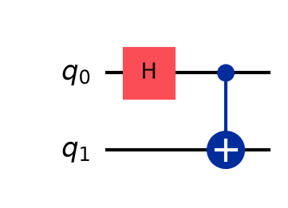

Allow about 2–3 hours with exercises. The scope is a fundamentals introduction, not every quantum algorithm or a complete error-correction course.

### 01 Qubit Probabilities

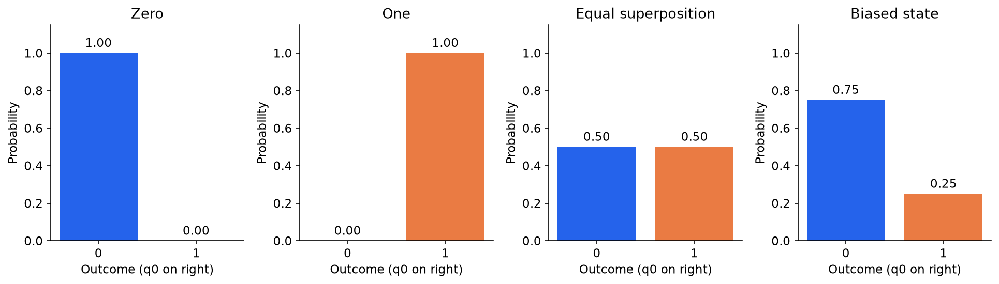

Qiskit calculates amplitudes and Born probabilities for all four preparations.

[SVG](assets/01_qubit_probabilities.svg) · [Numerical data](results/01_qubit_probabilities.csv)

### 02 Measurement Histogram

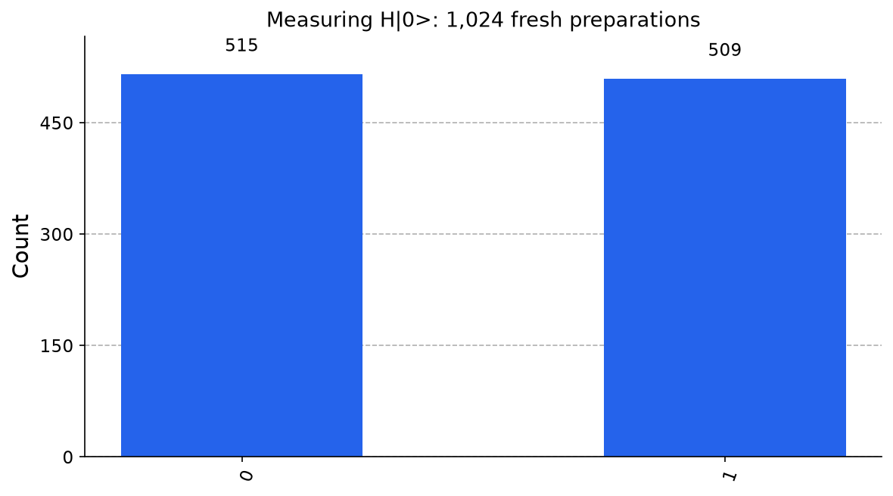

Sampling is finite-shot; exact theoretical probabilities are 0.5 and 0.5.

[SVG](assets/02_measurement_histogram.svg) · [Numerical data](results/02_measurement_histogram.csv)

### 03 Repeated Measurement Circuit

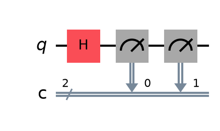

Aer simulates two measurements of one qubit; count strings display c1c0.

[SVG](assets/03_repeated_measurement_circuit.svg)

### 04 Gate Amplitudes

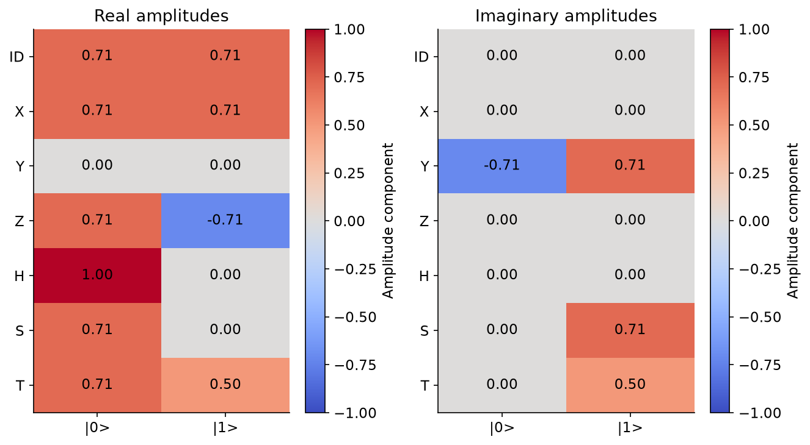

H maps |+> to |0>; phase gates change relative phase in different ways.

[SVG](assets/04_gate_amplitudes.svg) · [Numerical data](results/04_gate_amplitudes.csv)

### 05 Rotation Curve

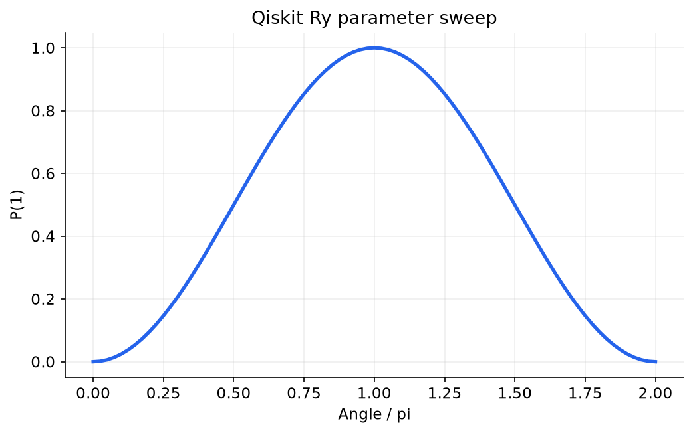

Ry(0) gives zero probability of 1; Ry(pi) gives probability 1.

[SVG](assets/05_rotation_curve.svg) · [Numerical data](results/05_rotation_curve.csv)

### 06 Bloch Sphere

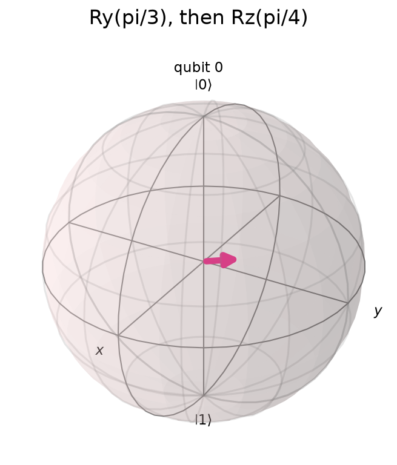

Qiskit plots the prepared state; its Bloch vector has unit length.

[SVG](assets/06_bloch_sphere.svg) · [Numerical data](results/06_bloch_sphere.csv)

### 07 Phase Interference

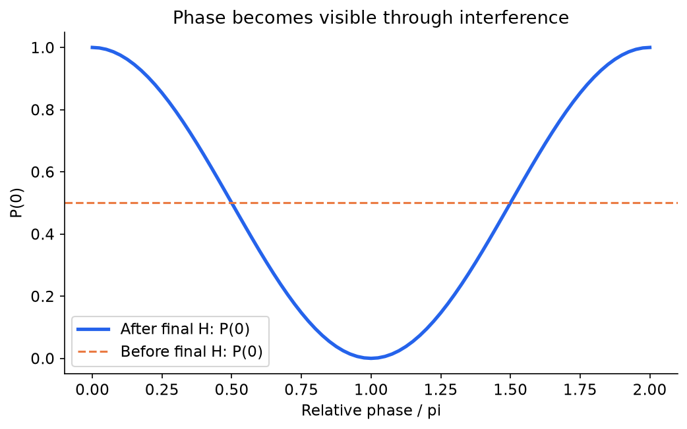

Relative phase changes the final probability; the input Z-basis probabilities remain 50/50.

[SVG](assets/07_phase_interference.svg) · [Numerical data](results/07_phase_interference.csv)

### 08 Toffoli Circuit

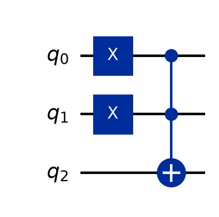

Starting from 011, CCX with controls q0 and q1 produces 111 (q2q1q0).

[SVG](assets/08_toffoli_circuit.svg)

### 09 Bell Circuit

Qiskit draws q0 on the top wire; H then CX prepares the Bell state.

[SVG](assets/09_bell_circuit.svg)

### 10 Entanglement Comparison

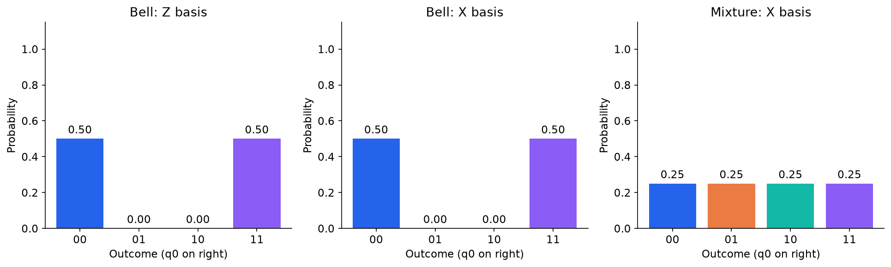

For these two preparations, X-basis results reveal Bell coherence that Z-basis counts alone cannot establish.

[SVG](assets/10_entanglement_comparison.svg) · [Numerical data](results/10_entanglement_comparison.csv)

### 11 Ghz Histogram

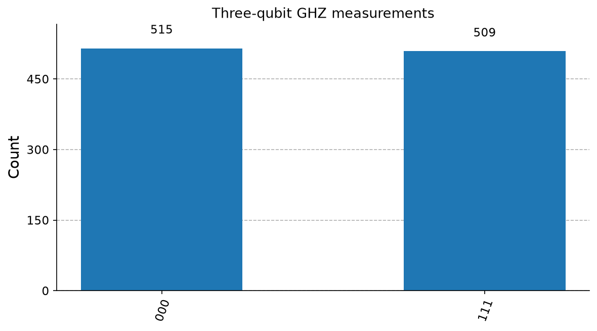

The ideal GHZ circuit produces only 000 and 111; finite counts fluctuate.

[SVG](assets/11_ghz_histogram.svg) · [Numerical data](results/11_ghz_histogram.csv)

### 12 Deutsch Results

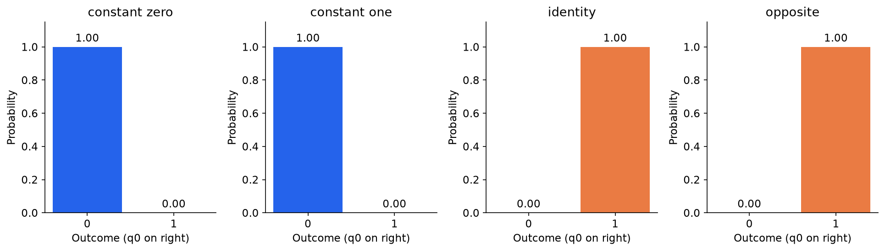

Both constant functions give q0=0; both balanced functions give q0=1 with certainty in the ideal circuit.

[SVG](assets/12_deutsch_results.svg) · [Numerical data](results/12_deutsch_results.csv)

### 13 Deutsch Circuit

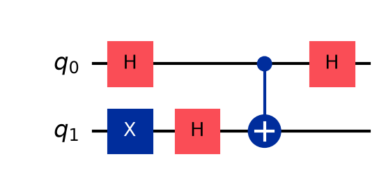

The identity oracle is CX(q0,q1); the auxiliary q1 begins in |->.

[SVG](assets/13_deutsch_circuit.svg)

### 14 Grover Results

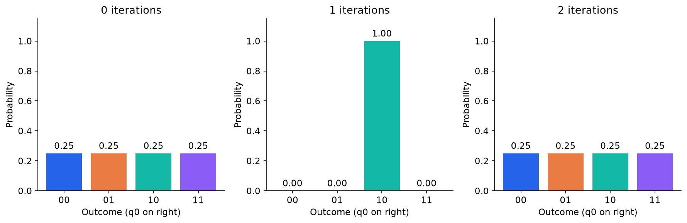

One iteration concentrates probability on 10; two return to a uniform distribution in this four-item example.

[SVG](assets/14_grover_results.svg) · [Numerical data](results/14_grover_results.csv)

### 15 Grover Circuit

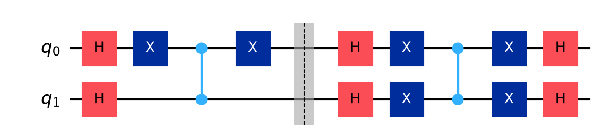

The left block marks 10; the right block amplifies it through interference.

[SVG](assets/15_grover_circuit.svg)

### 16 Teleportation Results

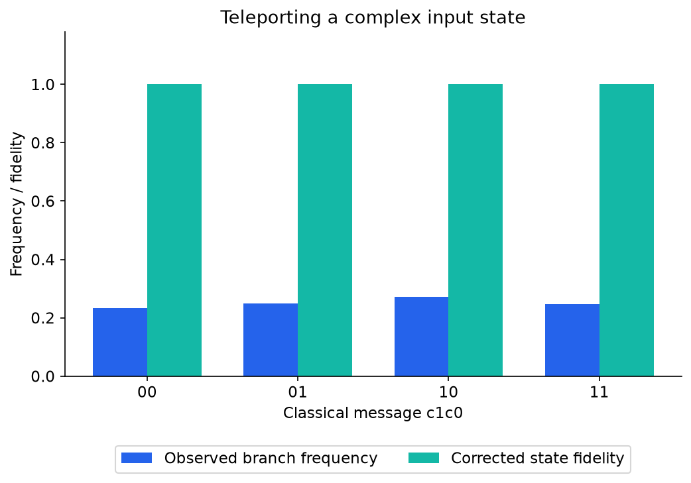

All four corrected branches have fidelity 1; their sampled frequencies are near 0.25.

[SVG](assets/16_teleportation_results.svg) · [Numerical data](results/16_teleportation_results.csv)

### 17 Teleportation Circuit

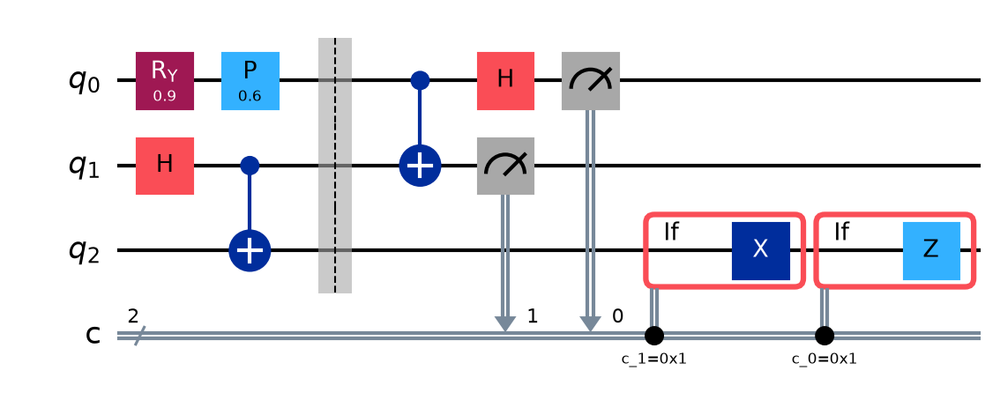

Qiskit if_test blocks execute X conditioned on c1, then Z conditioned on c0.

[SVG](assets/17_teleportation_circuit.svg)

### 18 Noise And Purity

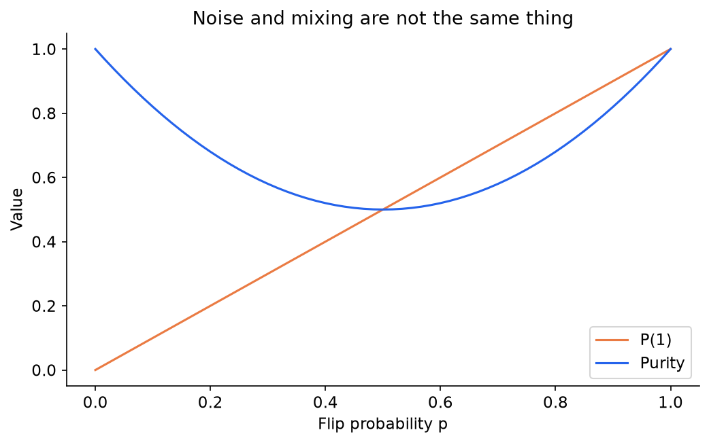

Mixing is strongest at p=0.5. A certain flip at p=1 returns to a pure state.

[SVG](assets/18_noise_and_purity.svg) · [Numerical data](results/18_noise_and_purity.csv)

### 19 Noise Histogram

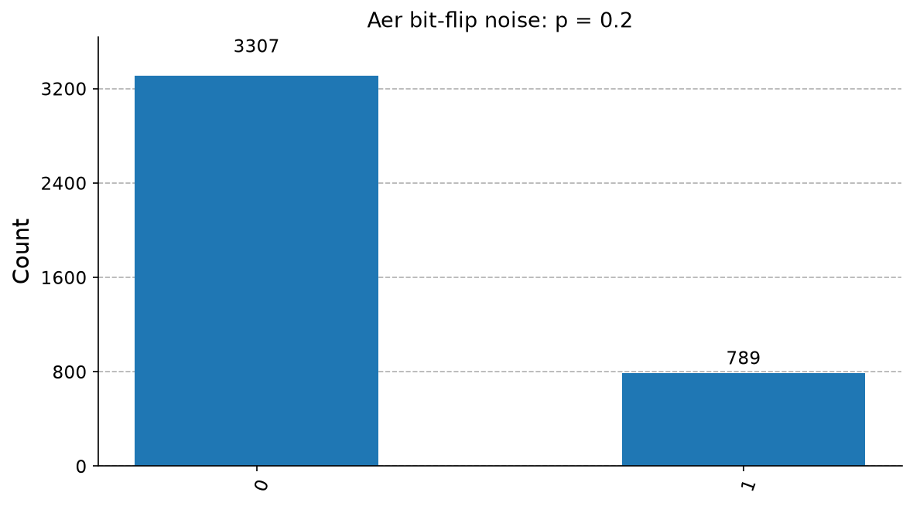

Sampled frequencies approach 0.8 for 0 and 0.2 for 1; they are not exact probabilities.

[SVG](assets/19_noise_histogram.svg) · [Numerical data](results/19_noise_histogram.csv)

### 20 Coherence Comparison

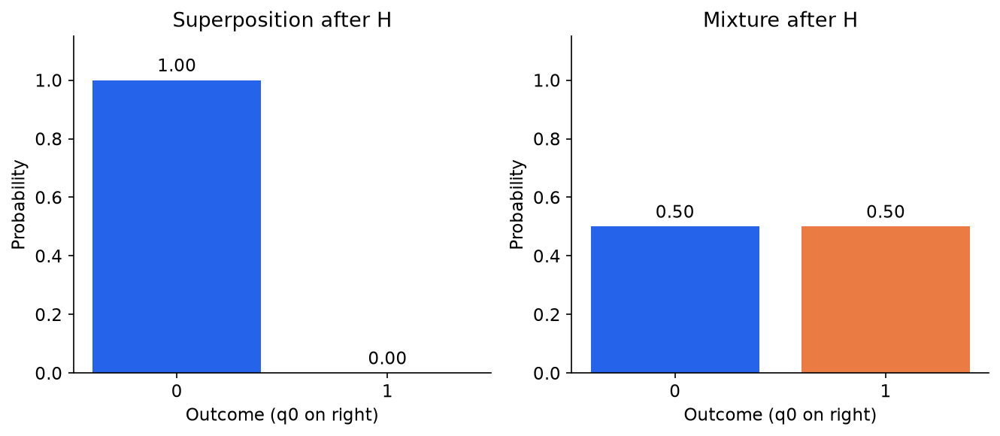

H maps |+> to |0>, while the maximally mixed state remains 50/50.

[SVG](assets/20_coherence_comparison.svg) · [Numerical data](results/20_coherence_comparison.csv)

### 21 Transpiled Circuit

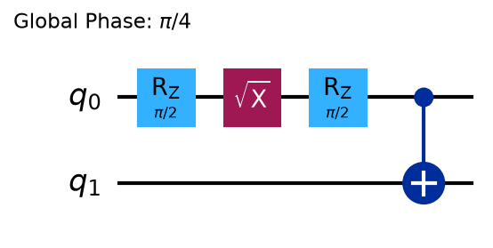

The compiled circuit implements the same Bell preparation with the selected gate basis.

[SVG](assets/21_transpiled_circuit.svg)

## Primary references

- [Qiskit bit ordering](https://quantum.cloud.ibm.com/docs/en/guides/bit-ordering)
- [StatevectorSampler API](https://quantum.cloud.ibm.com/docs/en/api/qiskit/qiskit.primitives.StatevectorSampler)
- [Qiskit package releases](https://pypi.org/project/qiskit/)
- [Aer simulator tutorial](https://qiskit.github.io/qiskit-aer/tutorials/1_aersimulator.html)
- [Aer noise-model tutorial](https://qiskit.github.io/qiskit-aer/tutorials/3_building_noise_models.html)
- [Aer conditional density-matrix saving](https://qiskit.github.io/qiskit-aer/stubs/qiskit_aer.library.save_density_matrix.html)
- [IBM Quantum Learning](https://quantum.cloud.ibm.com/learning)
- [Google Colab FAQ](https://research.google.com/colaboratory/faq.html)

